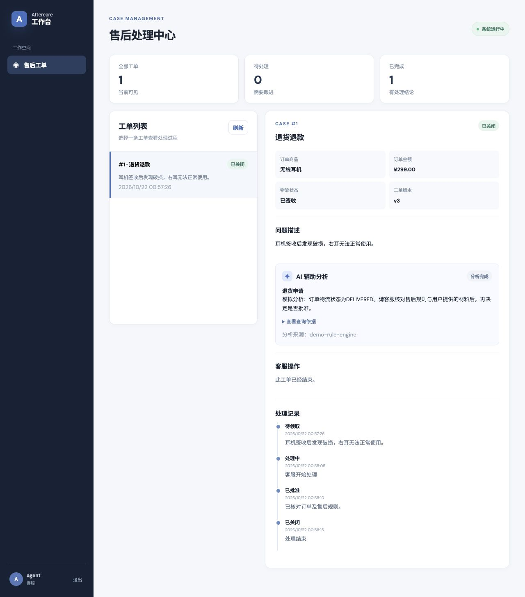

# AI 辅助订单售后与异常处理平台

一个可运行的 Java 后端作品：顾客提交售后申请，客服按状态处理，AI 查询订单、物流、规则与历史案例后提供建议。业务规则和最终决定由后端及客服控制。



## 功能

- 订单查询、角色权限、售后申请与处理记录
- 订单级串行校验、请求幂等键、工单版本校验
- 可恢复的异步 AI 分析任务，最多自动尝试三次，客服可手动重试
- 只读工具调用：订单、物流、规则、相似案例
- Redis 规则缓存；不可用时继续读取 MySQL
- React 客服台、Docker Compose 部署

技术栈：Java 21、Spring Boot、Spring Security、JDBC、Flyway、MySQL、Redis、React、Docker。初版异步任务由数据库任务表与定时工作器实现，不依赖消息队列。

## 快速运行

需要 Docker Compose：

```bash
cp .env.example .env
docker compose up --build
```

打开 `http://localhost:8088`。Compose 默认只绑定本机回环地址。演示账号：`customer / customer123` 与 `agent / agent123`；修改 `.env` 中的密码后，首次初始化数据库时会使用新密码。已有数据卷不会自动重置账号。

也可以只启动后端：设置好 Maven 和 Java 21 后运行 `mvn spring-boot:run`。默认使用内存 H2 数据库和模拟 AI 分析，重启后演示数据会重建。前端在 `web/` 下运行 `npm install && npm run dev`，访问 `http://localhost:5173`。

## 体验流程

1. 用顾客账号进入，选择已签收的耳机订单，提交退货申请。
2. 等待几秒后，查看 AI 建议与查询依据。
3. 切换客服账号，领取工单，填写处理理由，批准或拒绝，然后关闭。
4. 用运输中的键盘订单提交物流异常申请，比较两种业务场景。

## 接入真实模型

默认使用明确标记的模拟分析，使项目在没有 API 密钥时仍可运行。在 `.env` 中设置 `AI_API_KEY` 和支持工具调用及 JSON Schema 结构化输出的 `AI_MODEL`，即可调用 OpenAI API；`AI_ENDPOINT` 留空时默认使用 OpenAI Chat Completions 地址。使用其他兼容服务时，可将 `AI_ENDPOINT` 设为其完整接口 URL。不要将密钥提交到仓库。

每次分析最多发起五轮模型请求。模型只能调用 `get_order`、`get_logistics`、`get_policies`、`find_similar_cases` 四个只读工具，且查询对象由服务端根据当前工单确定；历史案例仅限同一客户、同一商品的已处理工单。模型必须按结构化格式返回异常分类、评估状态、建议、待补信息、冲突与实际使用的依据。服务端还会校验工具调用和依据引用。`READY` 仅表示信息足以提出建议；批准或拒绝仍需客服在独立接口操作。

未配置真实模型时，模拟分析会标为“证据不足”，供演示工作流使用，不能视为真实模型判断。接口错误、格式错误或越界调用会使分析任务失败并按既有重试机制处理。不同模型服务的兼容性应通过演示工单核实。

## 关键接口

| 方法 | 路径 | 作用 |
| --- | --- | --- |
| GET | `/api/me` | 当前身份 |
| GET | `/api/orders` | 可见订单 |
| GET | `/api/cases` | 可见售后单 |
| POST | `/api/cases` | 创建售后单，提交 `idempotencyKey` |
| GET | `/api/cases/{id}` | 工单、订单、记录和分析结果 |
| POST | `/api/cases/{id}/take` | 客服领取 |
| POST | `/api/cases/{id}/decision` | 客服批准/拒绝，提交 `expectedVersion` |
| POST | `/api/cases/{id}/close` | 关闭工单 |
| POST | `/api/cases/{id}/analysis/retry` | 重试失败的分析 |

接口通过 HTTP Basic 认证；演示前端把凭据保存在当前浏览器会话中。真实生产环境应改为 HTTPS、正式身份系统与更细的权限治理。

## 测试与项目边界

运行 `mvn test`。测试覆盖售后申请、幂等键、状态流转、权限、分析任务，以及正常、信息缺失、数据冲突、未授权工具、虚构依据、五轮上限和历史案例隔离。模型协议测试使用本地模拟 HTTP 服务，不消耗 OpenAI API 额度，也不能代替真实密钥的端到端验证。演示订单及物流数据由程序初始化；批准申请表示客服作出业务决定，不连接真实支付或退款服务。性能数字只有在实际压测后才会写入项目说明。

设计取舍与状态图见 [系统设计](docs/architecture.md)；AI 辅助开发与验证记录见 [开发记录](docs/ai-assisted-development.md)。
